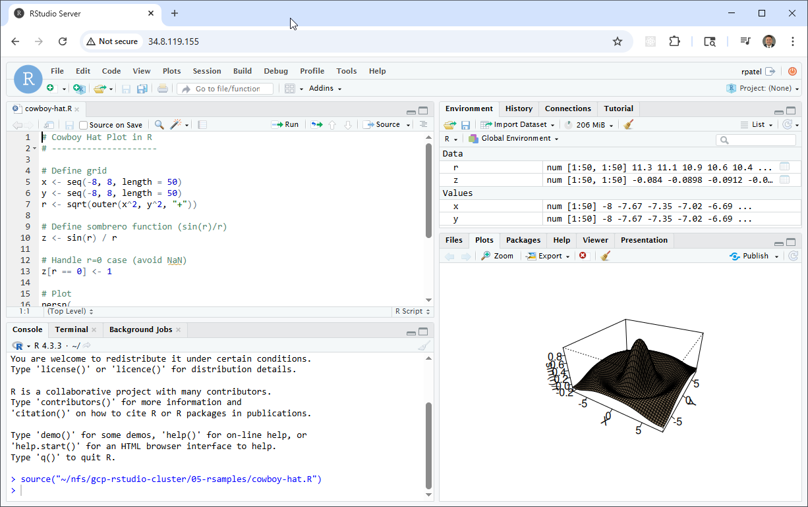
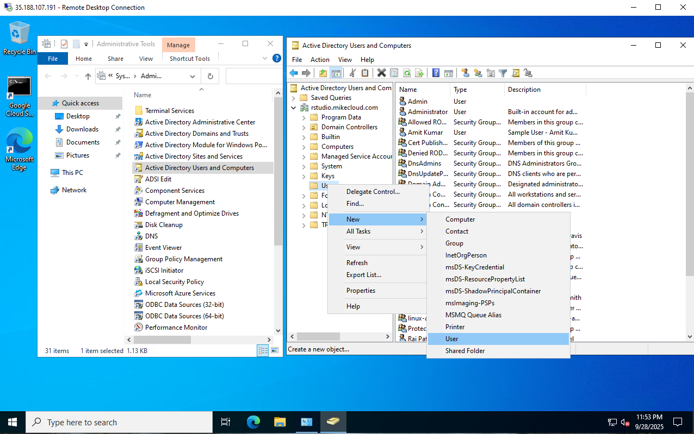
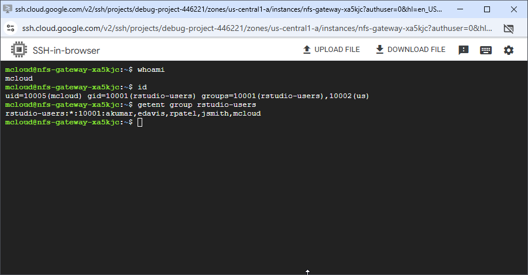

# RStudio Server on GKE: Kubernetes, Filestore and Active Directory

An **RStudio Server** cluster that runs as pods on **Google Kubernetes
Engine**, built on the [GCP Mini Active Directory](https://github.com/mamonaco1973/gcp-mini-ad)
lab and the VM-based
[gcp-rstudio-cluster](https://github.com/mamonaco1973/gcp-rstudio-cluster).
An **NGINX ingress controller** spreads users across RStudio pods; each pod
reads the AD join password from **Secret Manager** through Workload
Identity, joins a **mini-AD** domain when it starts, and mounts a
**Filestore** share for home directories and a shared R package library. A
Windows VM and a Samba gateway give admins access to the same files.



| Piece | Where | Role |
|---|---|---|
| **rstudio-gke** | GKE, zonal, `us-central1-a` | private nodes behind Cloud NAT; Workload Identity pool `<project>.svc.id.goog`; `default-node-pool` of `e2-standard-4`, 1 to 4 nodes with autoscaling |
| **NGINX ingress** | Helm, `ingress-nginx` | external network load balancer; HTTP 80; cookie session affinity (`rstudio_session`) |
| **rstudio** | StatefulSet | 2 replicas (HPA 2 to 4); requests 0.5 CPU and 500 MiB, limits 2 CPU and 3000 MiB; service account `rstudio-sa`; probes on `/auth-sign-in` |
| **rstudio-rw** | Google service account | `rstudio-sa` impersonates it through `roles/iam.workloadIdentityUser`; it has `roles/secretmanager.secretAccessor` |
| **rstudio-repository** | Artifact Registry, `us-central1` | the RStudio image |
| **nfs-server** | Filestore, `us-central1-a` | BASIC_HDD, 1 TB, NFSv3; a persistent volume mounts it at `/nfs` and its `home` directory at `/home` |
| **nfs-gateway-&lt;suffix&gt;** | `us-central1-a` | Ubuntu 24.04; joined to AD; mounts the share and serves `/nfs` over Samba |
| **win-ad-&lt;suffix&gt;** | `us-central1-a` | Windows Server 2022; joined to AD; RSAT; maps the gateway's share as `Z:` |
| **mini-AD** | `ad-subnet` in `gke-vpc` | [`module-gcp-mini-ad`](https://github.com/mamonaco1973/module-gcp-mini-ad) Samba DC for `rstudio.mikecloud.com` (`RSTUDIO`) |
| **Secret Manager** | project | `admin-ad-credentials` and one `*-ad-credentials` secret per user |

## Architecture

<picture>
  <source media="(prefers-color-scheme: dark)" srcset="architecture-dark.svg">
  
</picture>

Regenerate with `python3 make_diagram.py`. The gateway and Windows VM also
join the domain; those lines are left off the diagram to keep it readable.

- **`01-directory/`**: the VPC, subnet and Cloud NAT, the Artifact Registry
  repository, the passwords in Secret Manager, and the mini-AD DC with users
  and groups from `scripts/users.json.template`.
- **`02-servers/`**: Filestore, the gateway and Windows VMs, and their
  firewall rules.
- **`03-docker/rstudio/`**: the RStudio image (`Dockerfile`, install scripts
  and `startup.sh`).
- **`04-gke/`**: the cluster and node pool, the Workload Identity service
  accounts and binding, the NGINX Helm release, and
  `yaml/rstudio-app.yaml.tmpl` (storage, secret, StatefulSet, services,
  ingress and HPA).
- **`05-rsamples/`**: sample R scripts and `packages.R`.
- **`06-utils/`**: `getNextUID` / `getNextGID` scripts for adding AD users.

## How a pod starts

The image's `startup.sh` starts D-Bus, reads the AD admin password with
`gcloud secrets versions access` as the pod's Workload Identity, joins the
domain with `realm join` (SSSD with short names and the POSIX IDs from AD),
gives `linux-admins` passwordless sudo, writes `Rprofile.site` so the
library path is the user's own library, then `/nfs/rlibs`, then the system
library, and runs RStudio Server in the foreground. `/nfs/rlibs` belongs to
`rstudio-admins`.

## Users and groups

| User | uidNumber | Groups | Notes |
|---|---|---|---|
| jsmith | 10001 | rstudio-users, us, linux-admins, rstudio-admins, Domain Admins | sudo; writes `/nfs/rlibs` |
| edavis | 10002 | rstudio-users, us | |
| rpatel | 10003 | rstudio-users, india, linux-admins, rstudio-admins, Domain Admins | sudo; writes `/nfs/rlibs` |
| akumar | 10004 | rstudio-users, india | |

| Group | gidNumber |
|---|---|
| rstudio-users | 10001 (every user's primary group) |
| us | 10002 |
| india | 10003 |
| linux-admins | 10004 |
| rstudio-admins | 10005 |

## Prerequisites

* [A Google Cloud Account](https://console.cloud.google.com/)
* [Install gcloud CLI](https://cloud.google.com/sdk/docs/install)
* [Install Terraform](https://developer.hashicorp.com/terraform/install)
* [Install Docker](https://docs.docker.com/engine/install/)
* [Install kubectl](https://kubernetes.io/docs/tasks/tools/) and
  [jq](https://jqlang.github.io/jq/download/)

Put a service account key in the repository root as `credentials.json`. If
this is your first time watching our content, we recommend starting with
this video: [GCP + Terraform: Easy Setup](https://youtu.be/3spJpYX4f7I).

## Deploy

```bash
git clone https://github.com/mamonaco1973/gcp-rstudio-gke.git
cd gcp-rstudio-gke
./apply.sh
```

`check_env.sh` signs in with `credentials.json` and runs `api_setup.sh` to
enable the APIs. `apply.sh` applies `01-directory` and `02-servers`, builds
the RStudio image and pushes it to Artifact Registry, applies `04-gke`, then
renders and applies `rstudio-app.yaml`. It ends by running `validate.sh`:

```
NOTE: Linux nfs-gateway public IP address: 34.x.x.x
NOTE: Windows AD instance public IP address: 34.x.x.x
NOTE: Waiting for GKE ingress 'rstudio-ingress' external IP...
NOTE: Ingress external IP assigned: 34.x.x.x
NOTE: RStudio service is active at: http://34.x.x.x
```

## Try it

1. Open the RStudio URL and sign in as one of the users above, with the
   password from its `*-ad-credentials` secret.
2. Add a user:
   1. RDP to the **Windows RDP Host** as `jsmith` or `rpatel` and open
      **Active Directory Users and Computers** with **View > Advanced
      Features** on.
   2. Under the domain's **Users** container, create the user with a UPN
      such as `mcloud@rstudio.mikecloud.com` and an initial password.

      

   3. Run `Z:\gcp-rstudio-cluster\06-utils\getNextUID.bat` for the next
      free `uidNumber`.
   4. In **Attribute Editor**, set `uidNumber` to that value, `gidNumber` to
      `10001`, and `uid` to the login name.
   5. Under **Member Of**, add `rstudio-users` and any other groups.
   6. SSH to the **NFS Gateway Host** and check the mapping with
      `id mcloud`:

      

   7. Sign in to RStudio as the new user. They can't write `/nfs/rlibs`
      until they're in `rstudio-admins`.

## Teardown

```bash
./destroy.sh
```

## Notes

- **Lab only.** RStudio is served over plain HTTP, and the gateway and
  Windows VM accept SSH, SMB and RDP from `0.0.0.0/0`.
- Every pod joins the domain when it starts, so replaced pods leave
  computer accounts behind in AD.
- The gateway clones **gcp-rstudio-cluster** into the share, not this
  repository, so `06-utils` under `Z:` comes from that project (the
  `getNextUID` path above uses it).
- The node pool doesn't set a service account, so nodes run as the default
  Compute Engine service account with the `cloud-platform` scope.
- The old README listed `india` as 10002 and `us` as 10003; the template
  sets `us` to 10002 and `india` to 10003.
